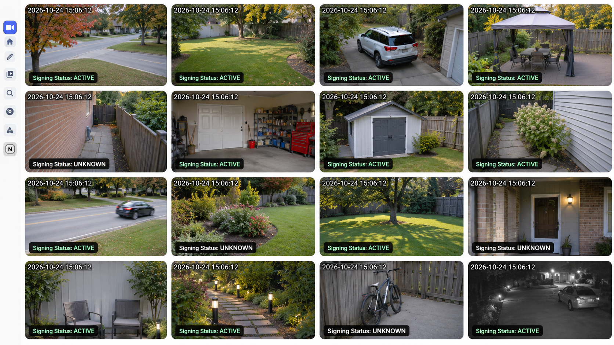
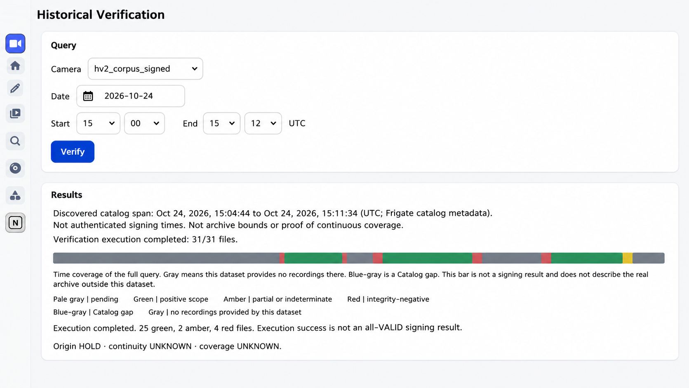
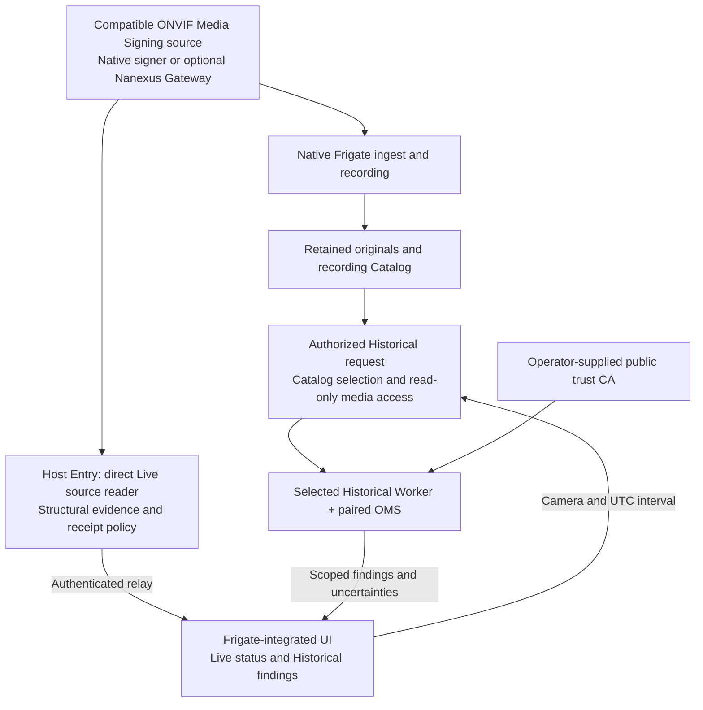

# Nanexus Frigate Signing Trust Pipeline

**See live signing evidence. Verify original retained recordings.**

Nanexus adds Live Monitor and Historical Verification to Frigate. It helps operators distinguish video that plays from signing evidence that is arriving, and inspect cryptographic findings in retained signed recordings.

M1 is a **source-integrated functional prototype for Frigate 0.18.2-cfa08c5 on Linux amd64**. Build the integration locally and mount it into the pinned official Frigate image.

[Source-only installation](#source-only-installation) · [Supported environment](docs/support-matrix.md) · [Verification semantics](#reading-results-accurately)

### Live Monitor

*Illustrative UI presentation based on owner-approved artwork, with only the upper-left bird logo removed. The 16-camera arrangement, pictured scenes, timestamps and status badges are illustrative—not evidence of a tested 16-camera deployment. Actual D5 validation used three real cameras, as described below.*

### Historical Verification

*Illustrative UI presentation of the wider timeline, based on owner-approved artwork with only the upper-left bird logo removed. Its dates, counts and classifications are illustrative, not a new Historical execution or a D5 screenshot. The accepted frontend and real validation evidence are described separately below.*

## What it does

| Capability | What the operator learns |
|---|---|
| **Live Signing Status** | Whether supported ONVIF Media Signing structures are arriving, how recently they were received and what continuity was observed in that Live session. Status is keyed to the configured camera/stream/context. |
| **Historical Verification** | The actual findings from running a selected Worker and its paired ONVIF Media Signing framework library (OMS) against original retained signed recordings selected by Frigate's Catalog. |
| **Native integration** | Existing Frigate recording, playback, login and TLS remain available. Nanexus entry points appear under the **N** menu; Host Entry starts through the existing native s6 integration as a non-root process. |

**Live ACTIVE does not mean that continuous video has been cryptographically verified.** Live inspects structural evidence and receipt freshness. It does not perform real-time signature verification, certificate-trust evaluation or prove replay freedom.

Historical verification is a separate operation. A positive signing finding applies only to its reported scope. Trust in the signing identity, completeness of context and continuity across recordings must be assessed from their own findings; they cannot be inferred from a colored block or successful playback.

## How the evidence flows

Native ingest and Host Entry use separate source connections. Live observations come directly from the current signed stream; Historical verification reads the retained originals through a read-only view. Catalog timestamps describe recordings, not authenticated signing time. The optional Gateway supplies signed media; it is not a prerequisite for using a compatible third-party signing source within the supported subset.

## Related Nanexus Projects

- **[Nanexus Media Signing Gateway](https://github.com/Nanexus-AI/nanexus-media-signing-gateway)** — an independent, optional source that adds ONVIF Media Signing to compatible H.264 camera streams. An existing three-channel Gateway deployment supplied the signed streams used in the real D5 E2E.
- **[Nanexus Video Trust Toolkit](https://github.com/Nanexus-AI/nanexus-video-trust-toolkit)** — a separately developed verification toolkit from which selected Historical C++ components are derived. Their exact source attribution is retained in [NOTICE](NOTICE).

Nanexus-owned code in both projects uses Apache-2.0; their third-party components retain separate terms. **You do not need to install all three projects.** Gateway is optional when another compatible signed source is available, and the Pipeline source already includes the selected Toolkit-derived components.

## Supported environment

| Area | M1 boundary |
|---|---|
| Frigate | **0.18.2-cfa08c5** only; exact upstream source and official image digest are pinned in the [guide](docs/frigate-source-build.md). |
| Platform | Native Linux amd64; Ubuntu 24.04 build profile; runtime Host Entry UID/GID 1000. Other architectures and Frigate versions are not qualified. |
| Build tools | Node 20; GCC/G++ `13.3.0-6ubuntu2~24.04.1`; Python with tar data-filter support; OpenSSL development headers, Meson, Ninja and Docker. Exact prerequisites and recorded reference versions are in the guide. |
| Signed input | Supported H.264 / ONVIF Media Signing evidence subset. Not every ONVIF camera or profile is supported. Host Entry does not accept credential-bearing RTSP URLs. |
| Trust and access | One operator-supplied public CA, native Frigate authentication/TLS and an operator-controlled loopback browser access path. |
| Operating scope | Bounded technical demonstration and ordinary operation with few users. No production HA, enterprise compliance or unattended 24/7 reliability guarantee. |

Live images load once per displayed camera in a mounted monitor session; image refresh/retry and video playback in those tiles are not provided. Historical requests select one authorized camera and a UTC interval of up to 30 minutes. Results are volatile, with no durable result archive, resume or evidence-export promise. Verification of exported MP4 files is outside this profile.

## Source-only installation

Use the [operator build and installation guide](docs/frigate-source-build.md) for the complete procedure. **M1 supplies source, not a derivative container image or prebuilt frontend/Worker/OMS package.** Operators obtain the official pinned Frigate source/image and build their own integration assets.

Source repository: [Nanexus-AI/nanexus-frigate-signing-trust-pipeline](https://github.com/Nanexus-AI/nanexus-frigate-signing-trust-pipeline). Access depends on repository visibility and permissions. For an immutable checkout, use the **full reviewed publication-source commit** recorded in the handoff; `main` is a moving branch. That documentation/source checkpoint is distinct from the accepted technical build source.

1. **Acquire and build the reviewed source.** Follow the guide's prerequisites and existing Builder workflow. Review your output manifest, explicitly accept that local build and run `verify --require-accepted`.
2. **Configure private runtime inputs.** Supply authorized signed streams, TLS, credentials and the public signing trust CA. Use the existing Selector to choose the built Worker/OMS pair and configure Host Entry.
3. **Start the official image with the documented 20 mounts.** Native `/init`, s6 and authentication/TLS remain in control; Host Entry runs non-root. Built assets and Historical's view of recordings are read-only. Native storage and the operational nginx copy remain separate.
4. **Log in and open N → Live Monitor or Historical Verification.** For Historical, choose an authorized camera and a real Catalog-backed UTC interval, then inspect its actual findings and limitations.

Place the operator's public CA at **`nanexus-runtime/trust/ca.pem`**, mounted read-only at **`/nanexus/trust/ca.pem`**. **A single trusted CA certificate is sufficient for the current supported setup.** It is not bundled. Signing private keys stay on the signer; the runtime TLS key is a separate private transport identity.

The guide covers safe remote-browser access, stop/start, container recreation and native-only recovery while retaining external data. Native retention/database behavior still applies. Keep original media and metadata intact; do not rewrite them to obtain a preferred verification result.

## Reading results accurately

| Live state | Meaning within the configured observation policy |
|---|---|
| **ACTIVE** | Recent supported structural signing evidence was received. |
| **DEGRADED** | Signing evidence is overdue while media continues to progress within the policy's limits. |
| **UNKNOWN** | No current supported determination, including startup, mapping/transport uncertainty, unsupported evidence or stale delivery. |

None of these is a cryptographic verdict, a certificate-trust result or a camera-health guarantee.

| Historical presentation | Meaning |
|---|---|
| **Pale gray / pending** | Work is not yet a completed finding. |
| **Green / positive scope** | Positive findings for the reported scope; not a claim about an entire recording history or signer identity. |
| **Amber / partial or indeterminate** | Context or evidence is insufficient for a stronger conclusion. **Amber is not equivalent to cryptographic failure.** |
| **Red / integrity-negative** | A reported integrity-negative finding. Infrastructure errors and missing media must be distinguished from this category. |
| **Blue-gray / Catalog gap; gray / no recordings supplied** | Recording-selection context in the proportional display, not a signature verdict. |

**Execution completed does not mean every recording segment is VALID.** Missing media, unresolved signing context, resource limits, origin/trust uncertainty and continuity or coverage limitations remain visible findings. Timeline widths use recording Catalog metadata; they do not prove continuous signing coverage. If optional coverage data is absent, the explicitly labelled ordinal grid is used instead. Invalid supplied coverage is not silently replaced by an invented timeline.

## What has actually been validated

**Real three-camera D5 acceptance:** three physical cameras through an existing signing Gateway, actual Live stills/statuses, native retained recordings and playback samples, and Windows 11 owner review of Live.

Two separate Historical runs were observed: the recorded UI run completed **13/13 files, all AMBER**, with origin **HOLD** and continuity/coverage **UNKNOWN**; a separate **owner-observed run completed 74/74 files: 72 GREEN and 2 AMBER**. Actual Worker/OMS execution and native recording Catalog/database integration were evidenced. Completion is not an all-VALID result, and the runs must not be merged. The [support contract](docs/support-matrix.md) retains detailed observations and provenance. These results are separate from the illustrations above.

**Later Historical restoration:** the wider timeline received focused offline/browser checks, owner visual approval and one independent clean Build/G1–G8 acceptance at source **`e84a7b7cfdbae960558a0582f4bd3cbf7dfee5e5`**. Worker/OMS and the compiled Frigate frontend matched D4; the separate Historical injection assets changed. `verify --require-accepted` passed. The full three-camera D5 E2E was **not repeated** on this frontend.

Local G8 acknowledges an operator-owned build, not publisher authorization or signature attestation. Independent ordinary-user installation/recovery and release decisions remain separate gates. See [E2E scope and evidence](docs/frigate-e2e-acceptance.md).

## Acknowledgements

We acknowledge these projects and their contributors:

- **[Frigate](https://github.com/blakeblackshear/frigate)** provides the native NVR, recording Catalog, API and user interface into which Nanexus integrates.
- **[ONVIF](https://www.onvif.org/)** provides the Media Signing work, and the **[ONVIF Media Signing Framework](https://github.com/onvif/media-signing-framework)** provides the signing/verification implementation. A licensed subset is a direct Pipeline dependency; the related Gateway and Toolkit also use the framework.
- **[ZLMediaKit](https://github.com/ZLMediaKit/ZLMediaKit)** provides the related Gateway's RTSP media infrastructure. **[ZLToolKit](https://github.com/ZLMediaKit/ZLToolKit)** and **[media-server](https://github.com/ireader/media-server)** are also recorded dependencies of that Gateway media stack. These are Gateway-side components, not direct Pipeline libraries.

Nanexus is independent and is not sponsored or endorsed by Frigate or ONVIF; no certification is claimed. These acknowledgements do not replace the mandatory copyright notices, license texts and portion-specific terms retained in [LICENSE](LICENSE), [NOTICE](NOTICE) and the vendored dependency records.

## License

Nanexus-controlled later contributions use **Apache-2.0**, with earlier **MIT** permissions and distinct third-party terms retained as mapped in [NOTICE](NOTICE) and [source license boundaries](docs/source-license-boundaries.md). The root [LICENSE](LICENSE) does not override those exceptions.

Frigate software portions retain Frigate's MIT terms. The vendored ONVIF Media Signing framework subset retains its [MIT license](third_party/media-signing-framework/LICENSE) and [provenance record](third_party/media-signing-framework/PROVENANCE). Toolkit-derived source attribution is recorded in NOTICE.

“Frigate” identifies the compatible upstream software. Software-source permissions do not grant unrestricted use of upstream logos or trademarks.

The source-only handoff excludes compiled frontend/Monaco bundles, fonts, Worker/OMS binaries, image layers, recordings, databases, credentials, keys, operator CA and private evidence. Operators obtain upstream inputs and dependencies separately. Locally generated branded outputs retain their own license, notice and trademark obligations; this README does not clear their redistribution.

This is a bounded functional prototype, not a production reliability or HA qualification. See the [installation and developer guide](docs/frigate-source-build.md) for installation and developer checks, and the [support matrix](docs/support-matrix.md) for known limitations.
